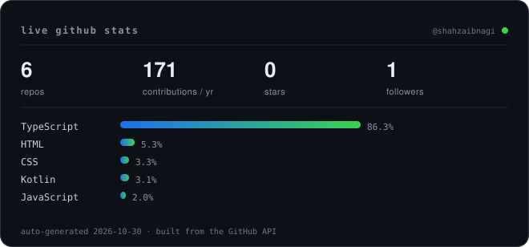

 

 

---

### What I run in production

Three years solo, shipping client work end to end: the interface, the API behind it, the data model and the servers they run on.

| Site | What it is |
|---|---|
| [zhscollections.com](https://zhscollections.com) | Fashion store |
| [ceezfragnances.shop](https://ceezfragnances.shop) | Perfume store — oud and attars |
| [mirabelcollections.com](https://mirabelcollections.com) | Clothing brand site |
| [adswinly.com](https://adswinly.com) | Ad attention platform |
| [dns.shahzaibnagi.dev](https://dns.shahzaibnagi.dev) | Free subdomain service — DNS API + panel |

### Open source work

**`sms-forwarder-android`** — Android app that forwards incoming SMS to a webhook you control. Kotlin, WorkManager for retries, a foreground service so aggressive OEM battery managers don't kill it, and a GitHub Action that builds the APK on push.

**`Asset-Manager`** — TypeScript monorepo: an Express API and a front-end sandbox wired together with pnpm workspaces.

**`BRAINWAVE-MD`** — command layer for a WhatsApp MD bot: 31 modules covering stickers, media downloaders, group tools and auto-responders, plus the Vercel pairing page in front of it.

**`pinterest-downloader`** — paste a pin URL, get the media back. Static interface plus a Vercel function that resolves through RapidAPI.

**`instagram-downloader`** — reels and video downloader with English and Urdu labels; the API base lives in config, not in the code.

**`youtube-downloader`** — endpoint that streams MP4 or extracts MP3 with `ytdl-core`, deployed as a serverless function.

---

### Toolbox

---

### Numbers

The card above is generated from the GitHub API by <code>scripts/stats.mjs</code> on a daily schedule — no third-party chart service.

---

---

Pakistan · <a href="https://shahzaibnagi.github.io/">portfolio</a> · <a href="https://dns.shahzaibnagi.dev">dns.shahzaibnagi.dev</a> · <a href="https://adswinly.com">adswinly.com</a> · <a href="https://zhscollections.com">zhscollections.com</a> · <a href="https://ceezfragnances.shop">ceezfragnances.shop</a> · <a href="https://mirabelcollections.com">mirabelcollections.com</a> · <a href="https://brandpromotions.shop">brandpromotions.shop</a>

